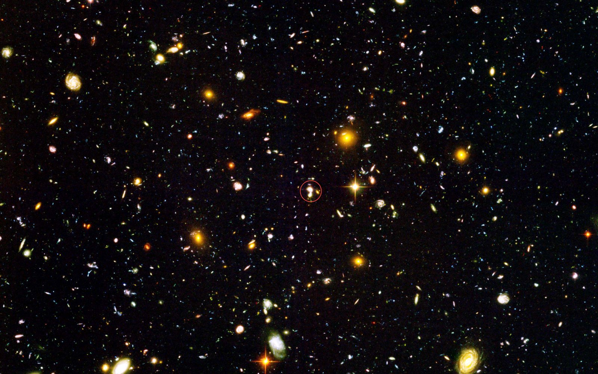
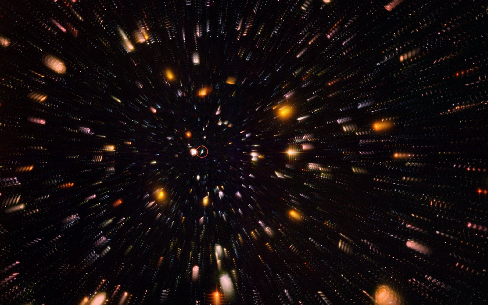
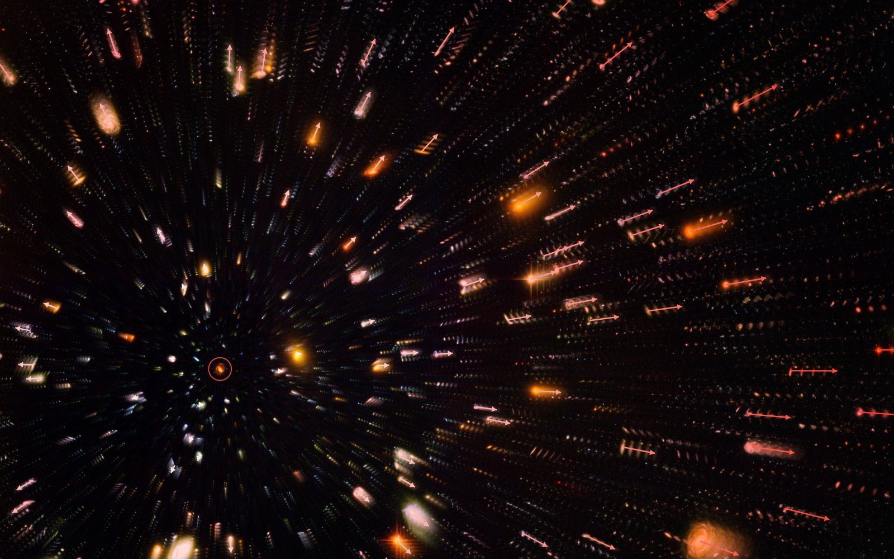
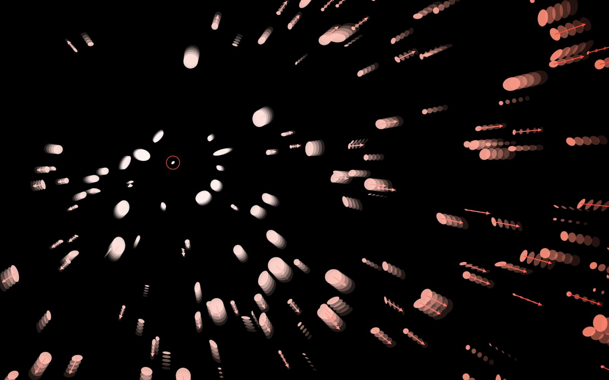

# Hubble's law demo

Live: https://rootlake.github.io/hubbleslawdemo/

This started as a demo I do in Adobe Illustrator. I draw a field of "galaxies" (just ellipses), copy the layer, scale the copy up a few percent, and lay it over the original with one galaxy lined up. Every other galaxy now looks like it's moving away from that one, and the farther away it is, the bigger the shift. Line up a different galaxy and the same thing happens around it. That's Hubble's law, and it shows why every galaxy can see itself as the center of the expansion.

This page does the same thing in a browser, with the Hubble Ultra Deep Field instead of hand-drawn ellipses.

Click any galaxy. The page stacks several copies of the image exactly on top of each other, centered on the galaxy you clicked, then scales each copy up a little more than the last. Nearby galaxies barely move. Distant ones leave long streaks.

Click somewhere else and it starts over from the new galaxy. The pattern looks the same from every home galaxy, which is the point I want students to notice.

## Velocity arrows and redshift

Turn on velocity arrows to see each galaxy's apparent motion. Arrows near home are short and white. They get longer and redder with distance, matching the red tint over the image that grows with distance from home.

## Simple mode

The Simple button switches to plain white ellipses, closer to the original Illustrator version. A density slider sets how many there are.

## Controls

You can change the number of layers (1 to 7), how much each layer is scaled, and how strong the red tint is. "Animate expansion" makes the expansion pulse in and out. Reset puts the sliders back to their defaults and holds the field still until the next click, which is also how the page opens. Press H or use the Hide button to get the panel out of the way when projecting.

## How it works

Each layer is the whole image scaled by `1 + i·k` around the home galaxy, so a galaxy at distance `d` from home moves by `i·k·d`. Displacement proportional to distance is Hubble's law (`v = H₀d`). The layers are drawn with screen blending, so the black sky adds nothing and the galaxies stack like transparent copies.

Everything is in `index.html` with no build step or dependencies. Open it in a browser, or serve the folder with any static server. The galaxy positions used for click targets were found ahead of time from the brightest blobs in `hudf.jpg` and are stored in the page.

## Credits

Hubble Ultra Deep Field image: NASA, ESA, S. Beckwith (STScI) and the HUDF Team ([heic0406a](https://esahubble.org/images/heic0406a/)). The copy here is resized to 2400 px with the background darkened to black.
